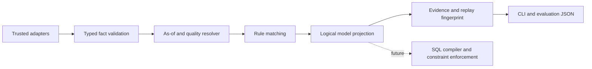

# DMF-CA v1.0 — implementation-ready research specification

Version 1.0.0 · 2026-10-31 · Proposed research design with executable reference semantics

## 1. Objective and contribution boundary

Investigate whether explicit, quality-aware and temporally qualified context can produce more appropriate logical data models than static models or role-only views. The research object is a model projection: selected attributes, entity relationships and declarative integrity/row constraints. A UI recommendation alone does not count as adaptation.

Proposed contributions are (C1) a bounded formal context algebra, (C2) a deterministic explainable projection pipeline, and (C3) a reproducible benchmark and independent domain-validation protocol. These are design contributions to evaluate, not claims of novelty or demonstrated superiority. Version 1.0 deliberately implements finite categorical context and explicit rules; ontology inference, probabilistic fusion, automatic ontology learning, physical schema evolution and distributed consensus are outside scope.

Context is motivated by Dey's operational treatment of context and context-aware applications ([Understanding and Using Context, 2001](https://sites.cc.gatech.edu/fce/ctk/pubs/PeTe5-1.pdf)). Provenance design is informed by the distinction between entities, activities and agents in [W3C PROV-O](https://www.w3.org/TR/prov-o/). This prototype stores plain evidence records; it does not claim PROV-O serialization or full compliance. A systematic literature review and novelty assessment remain research tasks.

## 2. Requirements and acceptance criteria

| ID | Requirement | Acceptance evidence |
|---|---|---|
| FR1 | Resolve role, purpose and academic phase as-of specified times | eligibility semantics and matrix tests |
| FR2 | Reject malformed categorical facts and invalid time/confidence values | constructor tests |
| FR3 | Abstain on unknown or contradictory required dimensions | missing/conflict/low/future/stale cases |
| FR4 | Produce fields, relationships and constraints with rule IDs | R1–R3 fixtures and demo |
| FR5 | Produce stable evidence and replay fingerprint | permutation and repeated-run tests |
| FR6 | Compare at least two baselines and one ablation | evaluation JSON |
| NFR1 | Run offline without runtime dependencies on Python 3.11+ | module commands and CI matrix |
| NFR2 | Preserve input and canonical base model | frozen dataclasses; no persistence writes |
| NFR3 | Retain reproducibility metadata | seed, corpus hash, environment and version |

Acceptance is conformance to this specification. It does not establish that the chosen rules describe any real university's policy.

## 3. Formal context semantics

Let the finite dimension set D = {role, purpose, phase}. Domains are role ∈ {student, lecturer, registrar}, purpose ∈ {study, grading, registration}, phase ∈ {open, closed}. All three are mandatory in v1, including rules that do not mention phase. This conservative choice is explicit and can be ablated in later work.

A fact f = (d, v, s, a, b, o, q) has dimension d, value v, source identifier s, valid interval [a,b), observed time o and confidence q ∈ [0,1]. Timestamps are integer UTC epoch seconds; a < b. Sources are identifiers, not proof of trust. Confidence is supplied metadata, not a calibrated probability.

A query C = (u,t,k,F) binds subject u, valid-time t, knowledge cutoff k and a finite tuple of subject-specific facts F. Facts must already be scoped to u by the adapter. Version 1 has no ingestion transaction log: o acts as observation/availability time for replay, not full bitemporal database history.

For TTL Δ = 300 seconds and quality threshold θ = 0.8:

E(C) = {f ∈ F | q ≥ θ ∧ o ≤ k ∧ a ≤ t < b ∧ 0 ≤ t−o ≤ Δ}.

For each dimension d, let Vd = {v | f ∈ E(C), f.dimension=d}. Resolution is v when |Vd|=1, unknown when |Vd|=0, conflict when |Vd|>1. Equal values from multiple sources corroborate rather than conflict; retain all eligible evidence. Conflicts abstain without source ranking, latest-write-wins or confidence-based arbitration. Old evidence is filtered first; low-quality contradictions cannot override eligible facts. No interpolation or derivation of facts occurs.

If any required dimension is unresolved, return `abstain` with dimension-specific issues and empty model output. Otherwise evaluate rules by conjunction of categorical equalities. A fully resolved context matching no rule returns `deny`, distinct from uncertainty. Matching rules yield `adapted` and the sorted set union of their outputs. Current antecedents are mutually exclusive. Any future rule with negative effects, priorities or overlapping contradictory constraints requires a new semantics version; do not silently add it to this union engine.

The `no_temporal` research ablation drops valid interval and freshness checks while retaining quality and knowledge-cutoff checks. It must never be substituted as the deployment default.

## 4. Base model and adaptation algebra

Canonical model M0 = (E,A,L,K): entities E, attributes A, relationships L and constraints K. Prototype entity schema:

| Entity | Attributes and intended types | Base integrity |
|---|---|---|
| Student | id: string PK | nonempty unique ID |
| Course | id: string PK; title: string; capacity: integer ≥0 | capacity nonnegative |
| Enrollment | student: Student FK; course: Course FK; grade: optional decimal [0,100]; status: enum pending/active/cancelled | composite unique (student,course), FK integrity |

The base schema is specified here; this prototype emits metadata, not DDL. Entities in an emitted model are inferred from attribute prefixes plus relationship endpoints. Enrollment FK columns are represented by relationship declarations even when not listed as display fields. A downstream schema compiler must materialize those keys and never interpret omitted display fields as dropped base columns.

Projection P(M0,C) = (A′,L′,K′,trace). A′ ⊆ A and L′ ⊆ L; K′ contains named contextual restrictions in addition to M0's invariants. Context changes can therefore alter relevance, associations and admissible rows without mutating M0. Apply P repeatedly to the same inputs and policy to obtain the same output. Do not project an already projected model; use M0 each time to prevent cumulative loss.

| Rule | Antecedent | Field projection | Relationships | Contextual constraints |
|---|---|---|---|---|
| R1-study | student ∧ study | Student.id, Course.id, Course.title, Enrollment.grade | Enrollment.student→Student.id; Enrollment.course→Course.id | own_enrollment |
| R2-grade | lecturer ∧ grading | Student.id, Course.id, Enrollment.grade | same two links | assigned_course |
| R3-register | registrar ∧ registration ∧ open | Student.id, Course.id, Course.capacity, Enrollment.status | same two links | capacity_limit, unique_student_course |

`own_enrollment`: Enrollment.student equals authenticated subject's student ID. `assigned_course`: course belongs to a server-verified teaching assignment. `capacity_limit`: active enrollment count cannot exceed Course.capacity; enforce transactionally under concurrency. `unique_student_course`: unique key across student and course, including concurrent requests. These constraints are named declarations only in v1. A later compiler must bind subjects through trusted identity mappings and implement predicates/transactions before querying or modifying actual records. Registrar/closed yields deny. Lecturer/study yields deny. All identity and assignment mappings remain outside this metadata-only prototype.

## 5. Architecture and data flow



1. Acquisition adapter obtains subject-scoped facts from identity, academic calendar and purpose selection. Source trust and subject ownership must be verified here. The shipped demo constructs synthetic facts directly; the Adapter protocol is an extension point.
2. Fact construction checks domains, nonempty source, integer times, valid interval and finite bounded confidence. Invalid input raises ValueError before inference.
3. Resolver applies eligibility and per-dimension unique-value semantics. Engine.project performs context validation and never reads wall-clock time.
4. Rule engine evaluates fixed, version-controlled RULES. There is no dynamic code execution, LLM call or user-supplied predicate evaluation.
5. Projector returns immutable sorted field, relation and constraint tuples. Abstain and deny expose no model fields.
6. Trace retains eligible supporting facts, rule IDs and issues. SHA-256 covers version, complete query including rejected evidence, resolution configuration and temporal-ablation flag. It is a replay identifier, not a signature or privacy protection. Version must change with policy changes. Duplicate input facts can change fingerprint, while deduplicated evidence and projection remain equal.
7. JSON boundary emits Decision.to_dict. CLI demo and evaluator are shipped. HTTP API, persistence, context ingestion and SQL execution are planned extensions, not implemented services.

For n input facts and r fixed rules: filtering is O(|D|n), matching O(r|D|), canonical evidence/input sorting O(n log n), memory O(n). No cache is used, avoiding stale cross-subject reuse.

## 6. Concrete Python contract

The executable public definitions are in `dmf_ca/core.py`:

```python
Fact(key: str, value: str, source: str, start: int, end: int,
     observed: int, confidence: float = 1.0)
Context(subject: str, at: int, known_at: int, facts: tuple[Fact, ...])
Engine(ttl: int = 300, threshold: float = 0.8)
Engine.project(context: Context, *, temporal: bool = True) -> Decision
Decision.to_dict() -> dict

class Adapter(Protocol):
    def acquire(self, subject: str, at: int, known_at: int) -> Context: ...
```

Decision includes status (`adapted`, `deny`, `abstain`), fields, relations, constraints, rules, evidence, issues and fingerprint. Python callers must pass the typed objects; arbitrary JSON dictionaries are not a supported input API. Times and confidence are validated for typed callers; this is not a hostile-input parser. Persistence adapters should construct/validate these objects and reject oversized fact sets before calling the engine.

Example: `python -m dmf_ca` emits R3-register at t=100 and abstains at t=1000 after valid interval ends. All input is synthetic. Change phase to closed with fresh evidence to obtain deny. Replay uses the same valid and knowledge times, not the current clock.

Future HTTP contract: POST /v1/projections with server-bound subject, at, known_at and validated facts; return JSON Decision (200 for all three decision statuses, 422 malformed data, 401/403 identity/source failures, 413 size limit). Do not return evidence source details to unauthorized clients. A future OpenAPI definition and endpoint implementation are milestone M2.

## 7. Verification and traceability

Unit tests check half-open intervals, inclusive TTL/threshold boundaries, knowledge cutoff, malformed facts/policy and input-order invariance. The independent evaluation matrix supplies 108 integration cases (3 roles × 3 purposes × 2 phases × 6 evidence conditions), including deny and abstain cases. Expected fields/constraints are specified in a separate policy table instead of imported from RULES. Matrix conformance is one unittest with subcases, not 108 independently authored domain observations.

The reproducibility test compares corpus hashes and semantic metrics while excluding nondeterministic timings. CI runs tests, demo and evaluation on Python 3.11–3.13. Future tests must cover compiler SQL injection resistance, FK closure, row filtering and concurrent capacity/unique constraints before handling actual records. There is no claim of database enforcement coverage in this release.

## 8. Operations, ethics and evolution

No database, telemetry, credentials or personal data are required. Evidence can contain identifying information in real deployments: redact raw subject/source identifiers in exported datasets, restrict trace access and define retention before ingestion. Confidence alone never grants trust. A forged registrar fact is accepted by this research engine; authentication must happen upstream. Failure to resolve context must block model release, and enforcement must independently deny rows if a compiler cannot implement every emitted constraint.

Keep immutable rule versions and context snapshots for replay. Changing domains, rule effects, resolution or canonicalization requires version bump and updated fixtures. Later persistence design: context_fact(id,subject,dimension,value,source,valid_from,valid_to,observed_at,confidence); projection_run(id,subject_ref,valid_at,known_at,model_version,policy_version,config_hash,input_hash,status); run_evidence(run_id,fact_id); run_rule(run_id,rule_id). Index facts on (subject,dimension,valid_from,valid_to,observed_at). Access and retention controls must apply to all tables. This design is proposed, not shipped DDL.

## 9. Delivery milestones

| Milestone | Deliverable | Exit criterion |
|---|---|---|
| M1 (this PR) | typed finite model, rules, demo, tests, reproducible synthetic comparison | local tests pass; review formal/code alignment |
| M2 | trusted adapters, declarative schema registry, SQL projection compiler, HTTP API | row/predicate, FK closure and concurrency tests; independent security review |
| M3 | blinded academic-policy corpus and expert annotation | held-out institution/term split; inter-rater agreement and adjudication |
| M4 | preregistered evaluation, robustness and scaling study | paired uncertainty estimates and reproducibility package, negative results retained |

Open decisions for domain owners: whether phase is required for study/grading; how lecturer assignments map to identities; multi-role subjects; campus-specific grading and enrollment policy; source trust order; confidence calibration. These do not block the bounded M1 semantics but must be resolved before external deployment.
